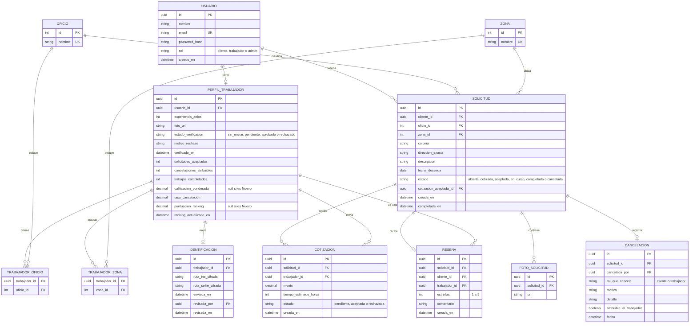

# Contrato Técnico — OficioYa

| Campo | Valor |
|---|---|
| Equipo / Autor(es) | Javier Alejandro Santiago Salinas, Alejandro Lita Camacho, Jesus Eduardo Pineda Alcazar y Manuel Alfonso Castillo Moar |
| Versión | 1.2 |
| Fecha | 2026-11-25 |
| Documento de origen | [01-vision-alcance_OficioYa_Santiago.md](./01-vision-alcance_OficioYa_Santiago.md) |
| Estado | Vigente (entrega final) |

---

## 1. Contexto

OficioYa es una aplicación web responsiva, pensada para el celular, que conecta a clientes de Puebla con trabajadores de oficios cuya identidad fue verificada. Resuelve la falta de confianza al contratar: el cliente no puede comprobar quién es el trabajador ni cómo trabaja, y el buen trabajador no tiene cómo demostrar su reputación. La reputación se construye solo con trabajos completados dentro de la plataforma. Detalle del problema y requisitos: [Etapa 1](./01-vision-alcance_OficioYa_Santiago.md).

**Módulos** (se usan en las etiquetas de los criterios de la sección 4):
- **M1** — Perfiles y verificación (RF-01, RF-02, RF-03)
- **M2** — Solicitudes y cotizaciones (RF-04 a RF-08)
- **M3** — Reseñas y ranking (RF-09, RF-10)

**Alcance del MVP:**

| ID | Requisito (título corto) | Prioridad | ¿Entra al MVP? |
|---|---|---|---|
| RF-01 | Registro e inicio de sesión | Must | Sí |
| RF-02 | Perfil de trabajador | Must | Sí |
| RF-03 | Verificación de identidad por administrador | Must | Sí |
| RF-04 | Búsqueda de trabajadores ordenada por ranking | Must | Sí |
| RF-05 | Crear solicitud | Must | Sí |
| RF-06 | Enviar cotización | Must | Sí |
| RF-07 | Control de estados de la solicitud | Must | Sí |
| RF-08 | Registro de cancelaciones | Must | Sí |
| RF-09 | Reseña de trabajo completado | Must | Sí |
| RF-10 | Recálculo del ranking | Must | Sí |
| RF-11 | Avisos dentro de la app | Should | Sí (v1.0; avisos por oficio y zona en v1.1) |
| RF-12 | Respuesta pública a reseñas | Should | Sí (v1.0; visible en el perfil público en v1.1) |
| RF-13 | Reportes y suspensión | Should | Sí (v1.0; reactivación en v1.1) |
| RF-14 | Panel de estadísticas del trabajador | Could | Sí (v1.0) |
| RF-15 | Historial de solicitudes del cliente | Could | Sí (adelantado en el MVP) |
| RF-16 | Ajuste de precio con aprobación del cliente | Must | Sí (v1.0, cambio solicitado por el usuario) |
| RF-17 | Porcentaje de trabajos con ajuste en el perfil del trabajador | Should | Sí (v1.0) |
| RF-18 | Perfil público del trabajador con reseñas y respuestas | Should | Sí (v1.1) |
| RF-19 | Tope de ajuste configurable por oficio (administrador) | Could | Sí (v1.1) |
| RF-20 | Celular de contacto en el registro y en "Mi cuenta" | Must | Sí (v1.2) |
| RF-21 | Preguntas antes de cotizar | Should | No (pendiente P2) |
| RF-22 | Horario de visita propuesto por el trabajador y confirmado por el cliente | Should | Sí (v1.2) |
| RF-23 | Contacto directo por WhatsApp o llamada durante el trabajo activo | Must | Sí (v1.2) |
| RF-24 | Confirmación del monto pagado por ambas partes | Should | No (pendiente P2) |
| RF-25 | Volver a contratar al mismo trabajador | Could | No (pendiente P3) |
| RF-26 | "Terminado" marcado por el trabajador con 72 h para disputa | Must | Sí (v1.2) |
| RF-27 | Cambiar contraseña | Must | Sí (v1.2) |
| RF-28 | Eliminar cuenta (derecho de cancelación) | Must | Sí (v1.2) |
| RF-29 | Aviso de privacidad y términos aceptados al registrarse | Must | Sí (v1.2) |

> Prioridad: **Must** (sin esto el MVP no sirve), **Should** (importante, pero hay alternativa), **Could** (deseable).

---

## 2. Decisiones de arquitectura

### ADR-01 — API REST primero, como base del complemento móvil (Etapa 6)

- **Contexto:** en la Etapa 6 se agregará un complemento móvil. Si la lógica de negocio (estados de la solicitud, ranking, permisos por rol) vive dentro de la interfaz web, habría que reescribirla para la app.
- **Opciones consideradas:** (A) monolito con vistas renderizadas en el servidor; (B) API REST independiente, con la web como primer cliente; (C) backend como servicio (p. ej. Firebase) con las reglas en el cliente.
- **Decisión:** B. Toda la lógica vive en una API REST versionada (`/api/v1`); la web solo consume endpoints.
- **Justificación:** la app de la Etapa 6 reutilizará exactamente los endpoints de la sección 3.2, sin duplicar reglas. En C, reglas como el ranking o las transiciones de estado quedarían en el cliente, donde se pueden manipular. A acopla la lógica al HTML y obliga a reescribirla para móvil.
- **Consecuencias:** se gana que la Etapa 6 solo construya interfaz y que la API se pueda probar sin la UI. Se pierde simplicidad: son dos proyectos que desplegar, hay que configurar CORS y mantener la versión de la API para no romper la app móvil.

### ADR-02 — Stack: Node.js + Express, PostgreSQL y React

- **Contexto:** cuatro integrantes, un semestre de plazo y datos muy relacionados entre sí (solicitud → cotizaciones → reseña) con restricciones fuertes: una reseña por solicitud y una sola cotización aceptada.
- **Opciones consideradas:** backend en Node.js + Express, Python + FastAPI o Java + Spring Boot; base de datos PostgreSQL o MongoDB; frontend en React o JavaScript sin framework.
- **Decisión:** Node.js 20 + Express + Prisma (ORM), PostgreSQL 16 y React 18 + Vite.
- **Justificación:** un solo lenguaje (JavaScript) en frontend y backend permite que cualquier integrante trabaje en ambos. PostgreSQL garantiza con `UNIQUE`, llaves foráneas y transacciones reglas que en MongoDB habría que programar a mano, como aceptar una cotización y rechazar las demás de forma atómica. React permite reutilizar componentes (tarjeta de trabajador, formularios) en todas las pantallas. Prisma da migraciones versionadas.
- **Consecuencias:** se gana integridad de datos garantizada por la base de datos y un ecosistema amplio. Se pierde el tipado fuerte que daría Spring Boot, por lo que se compensa con validación de entradas (zod) y pruebas automatizadas.

### ADR-03 — Interfaz web mobile-first

- **Contexto:** la mayoría de los usuarios usará el celular, y muchos trabajadores tienen equipos de gama baja (supuesto de la Etapa 1).
- **Opciones consideradas:** (A) app nativa Android/iOS; (B) app multiplataforma (Flutter); (C) web responsiva diseñada primero para 360 px.
- **Decisión:** C. El CSS base se escribe para 360 px y se amplía con `media queries` de `min-width` para tableta y escritorio.
- **Justificación:** no requiere instalación, se comparte con un enlace por WhatsApp para el piloto y es un solo código. Diseñar desde 360 px obliga a priorizar contenido y cumple directamente RNF-05. A y B requieren publicar en tiendas y retrasan las pruebas con usuarios.
- **Consecuencias:** se gana acceso inmediato e iteración rápida. Se pierden notificaciones push confiables en iOS, y el acceso a la cámara se limita a `<input type="file" capture>`, suficiente para fotografiar la identificación.

### ADR-04 — Autenticación con JWT de acceso corto y refresh token

- **Contexto:** RNF-02 exige que la sesión expire tras 24 h de inactividad; el mecanismo debe servir igual para la web y la futura app móvil (ADR-01); hay tres roles (cliente, trabajador, administrador).
- **Opciones consideradas:** (A) sesión en servidor con cookie; (B) JWT de larga duración; (C) JWT de acceso de 15 min + refresh token opaco guardado como hash en la base de datos, con expiración deslizante de 24 h.
- **Decisión:** C. El rol viaja en el JWT y un middleware lo valida en cada ruta.
- **Justificación:** el header `Authorization: Bearer` funciona igual en navegador y en app nativa. Como el refresh token vive en la base de datos, se puede revocar, y su expiración deslizante implementa literalmente "24 h de inactividad". B no se puede revocar ni expira por inactividad; A es incómodo para clientes móviles.
- **Consecuencias:** se gana un mismo mecanismo para web y móvil, revocable. Se pierde simplicidad: hay que rotar el refresh token y el frontend debe renovar la sesión al recibir `401`.

### ADR-05 — Almacenamiento cifrado de identificaciones oficiales

- **Contexto:** la INE y la selfie con la INE son datos personales sensibles; RNF-03 exige cifrado y acceso exclusivo de administradores.
- **Opciones consideradas:** (A) carpeta pública del servidor; (B) archivos guardados como BLOB en PostgreSQL; (C) archivos en un volumen privado (fuera de la carpeta pública), cifrados con AES-256-GCM, con la clave en una variable de entorno y descifrados solo al servirlos por un endpoint de administrador.
- **Decisión:** C, detrás de una interfaz de almacenamiento que permita migrar después a un bucket privado (p. ej. S3) sin tocar el resto del código.
- **Justificación:** A expone las INE a cualquiera que adivine la URL. B infla la base de datos y sus respaldos. Con C, aunque alguien copie el disco, sin la clave no puede leer nada, y el único camino de lectura es un endpoint protegido por rol.
- **Consecuencias:** se gana cumplimiento de RNF-03. Se pierde la posibilidad de recuperar los archivos si se pierde la clave, así que debe respaldarse fuera del repositorio, y el archivo `.env` nunca se sube a Git.

### ADR-06 — Reglas de negocio centralizadas: máquina de estados y ranking en servicios del backend

- **Contexto:** RF-07, RF-08 y RF-10 cruzan los tres módulos. Si cada endpoint cambia estados a su manera, aparecen transiciones inválidas o rankings desactualizados.
- **Opciones consideradas:** (A) cada controlador valida lo suyo; (B) triggers en la base de datos; (C) un único servicio de transiciones con una tabla de transiciones permitidas (sección 3.3), donde cada transición corre en una transacción y dispara el recálculo del ranking en un servicio de ranking.
- **Decisión:** C. Además, el ranking se guarda precalculado y un proceso diario (03:00) lo recalcula para aplicar el cambio de peso por antigüedad de las reseñas.
- **Justificación:** una sola tabla de transiciones es una sola fuente de verdad y se prueba fácilmente (CA-07.x). La transacción garantiza que aceptar una cotización y rechazar las demás ocurra completo o no ocurra (CA-07.5). Los triggers esconden la lógica y son difíciles de probar. Precalcular el ranking evita calcular cientos de promedios en cada búsqueda (RNF-01), y el proceso diario evita que los pesos por antigüedad se queden desactualizados.
- **Consecuencias:** se ganan reglas probables de forma aislada. Se pierde algo de frescura: entre recálculos diarios, el peso por antigüedad puede tener hasta 24 h de desfase, lo cual es aceptable para el MVP. Hay un proceso programado (node-cron) que mantener.

---

## 3. Modelo de datos e interfaces

### 3.1 Modelo de datos



**Restricciones que la base de datos debe garantizar:**
- `USUARIO.email` único; `PERFIL_TRABAJADOR.usuario_id` único (un usuario tiene como máximo un perfil).
- `COTIZACION (solicitud_id, trabajador_id)` único: un trabajador cotiza una sola vez por solicitud.
- `RESENA.solicitud_id` único: una reseña por solicitud. `CANCELACION.solicitud_id` único.
- `RESENA.estrellas` entre 1 y 5; `COTIZACION.monto` > 0; `COTIZACION.tiempo_estimado_horas` > 0.
- El peso por antigüedad **no se guarda** en `RESENA`: se calcula al recalcular el ranking, porque cambia con el tiempo.

### 3.2 Contratos de interfaz (API)

Todas las rutas usan el prefijo `/api/v1`. Excepto las de `/auth` y `/catalog`, todas requieren `Authorization: Bearer <token>` y devuelven `401` sin token válido. Formato de error común: `{ "error": { "code": "...", "message": "..." } }`, con el mensaje en español.

| Método y ruta | Descripción | Entrada | Salida exitosa | Errores |
|---|---|---|---|---|
| `POST /auth/register` | Registrar cliente o trabajador | `{ nombre, email, password, rol }` (rol: `cliente` o `trabajador`) | `201 { usuario, accessToken, refreshToken }` | `400` validación, `409` correo ya registrado |
| `POST /auth/login` | Iniciar sesión | `{ email, password }` | `200 { usuario, accessToken, refreshToken }` | `401` credenciales incorrectas |
| `POST /auth/refresh` | Renovar sesión | `{ refreshToken }` | `200 { accessToken, refreshToken }` | `401` token inválido o vencido |
| `GET /catalog` | Catálogo de oficios y zonas | — | `200 { oficios, zonas }` | — |
| `PUT /workers/me/profile` | Crear o actualizar perfil | multipart: `oficioIds[]`, `zonaIds[]`, `experienciaAnios`, `foto` | `200 { perfil }` | `400`, `403` no es trabajador, `413` foto > 5 MB |
| `POST /workers/me/identity` | Enviar INE y selfie | multipart: `ine`, `selfie` (JPG o PNG, ≤ 5 MB c/u) | `202 { estadoVerificacion: "pendiente" }` | `400` formato, `403`, `409` ya aprobado, `413` |
| `GET /admin/verifications?estado=pendiente` | Lista de verificaciones por revisar | — | `200 [ { trabajadorId, nombre, enviadaEn } ]` | `403` no es admin |
| `GET /admin/verifications/:trabajadorId/files/:tipo` | Ver INE o selfie descifrada (`tipo`: `ine` o `selfie`) | — | `200` imagen | `403`, `404` |
| `PATCH /admin/verifications/:trabajadorId` | Aprobar o rechazar | `{ decision, motivo }` (decision: `aprobar` o `rechazar`) | `200 { estadoVerificacion }` | `400` rechazo sin motivo, `403`, `404`, `409` no está pendiente |
| `GET /workers?oficioId=&zonaId=` | Buscar trabajadores verificados | parámetros de consulta | `200 [ { id, nombre, fotoUrl, puntuacionRanking, trabajosCompletados, esNuevo } ]` (puede ser `[]`) | `400` falta oficio o zona |
| `POST /requests` | Crear solicitud | multipart: `oficioId`, `zonaId`, `colonia`, `direccionExacta`, `descripcion`, `fechaDeseada`, `fotos[]` (0 a 5) | `201 { solicitud }` con estado `abierta` | `400`, `403` no es cliente, `413` |
| `GET /requests/available` | Solicitudes abiertas o cotizadas del oficio y zonas del trabajador | — | `200 [ solicitud sin direccionExacta ]` | `403` no verificado |
| `GET /requests/:id` | Detalle de solicitud | — | `200 { solicitud }`; `direccionExacta` solo para el cliente dueño y el trabajador aceptado | `403`, `404` |
| `POST /requests/:id/quotes` | Enviar cotización | `{ monto, tiempoEstimadoHoras }` | `201 { cotizacion }` | `400`, `403` no verificado u oficio/zona distintos, `404`, `409` ya cotizó o estado no lo permite |
| `GET /requests/:id/quotes` | Ver cotizaciones (cliente dueño) | — | `200 [ cotizacion ]` | `403`, `404` |
| `POST /requests/:id/accept` | Aceptar una cotización | `{ cotizacionId }` | `200 { solicitud }` con estado `aceptada` | `400`, `403`, `404`, `409` transición no permitida |
| `POST /requests/:id/start` | Iniciar trabajo (trabajador aceptado) | — | `200 { solicitud }` con estado `en_curso` | `403`, `409` |
| `POST /requests/:id/complete` | Confirmar trabajo terminado (cliente dueño) | — | `200 { solicitud }` con estado `completada` | `403`, `409` |
| `POST /requests/:id/cancel` | Cancelar | `{ motivo, detalle }` | `200 { solicitud, cancelacion }` | `400`, `403`, `409` |
| `POST /requests/:id/review` | Reseñar trabajo completado | `{ estrellas, comentario }` (comentario opcional, máx. 500 caracteres) | `201 { resena }` | `400`, `403`, `409` ya reseñada, `422` no completada o plazo vencido |

### 3.3 Máquina de estados de la solicitud

Cualquier transición que no aparezca en esta tabla responde `409` y no modifica nada.

| Desde | Hacia | Quién | Endpoint | Efectos en otros módulos |
|---|---|---|---|---|
| `abierta` | `cotizada` | Sistema, al recibir la primera cotización | `POST /requests/:id/quotes` | — |
| `cotizada` | `aceptada` | Cliente dueño | `POST /requests/:id/accept` | Cotización elegida → `aceptada`; las demás → `rechazadas`; `solicitudes_aceptadas` +1 del trabajador; se libera la dirección exacta al trabajador |
| `aceptada` | `en_curso` | Trabajador aceptado | `POST /requests/:id/start` | — |
| `en_curso` | `completada` | Cliente dueño | `POST /requests/:id/complete` | `trabajos_completados` +1; se habilita la reseña por 30 días; se recalcula el ranking (M3) |
| `abierta` o `cotizada` | `cancelada` | Cliente dueño | `POST /requests/:id/cancel` | Cotizaciones pendientes → `rechazadas`; no es atribuible al trabajador |
| `aceptada` o `en_curso` | `cancelada` | Cliente dueño | `POST /requests/:id/cancel` | No es atribuible al trabajador |
| `aceptada` o `en_curso` | `cancelada` | Trabajador aceptado | `POST /requests/:id/cancel` | Atribuible: `cancelaciones_atribuibles` +1; se recalcula el ranking (M3) |

### 3.4 Regla de negocio: ranking (detalle operativo de RF-10)

- **Antigüedad** de una reseña = días completos desde `creada_en`. **Peso:** 1.0 si es menor a 90 días; 0.6 de 90 a 365 días; 0.3 si es mayor a 365 días.
- **Calificación ponderada** = Σ(estrellas × peso) / Σ(peso).
- **Tasa de cancelación** = `cancelaciones_atribuibles` / `solicitudes_aceptadas`. Si `solicitudes_aceptadas` = 0, la tasa es 0.
- **Puntuación de ranking** = calificación ponderada × (1 − tasa de cancelación). Se guarda con precisión completa y se muestra redondeada a 2 decimales.
- **Nuevo:** un trabajador con menos de 3 trabajos completados, o sin ninguna reseña, tiene `puntuacion_ranking = null` y se muestra con la etiqueta "Nuevo".
- **Orden de búsqueda:** primero los trabajadores con puntuación (descendente; desempate por más trabajos completados y después por fecha de verificación más antigua); después los "Nuevo", por fecha de verificación más antigua.
- **Momentos de recálculo:** al registrar una reseña, al completar una solicitud, al registrar una cancelación atribuible y en el proceso diario de las 03:00 (ADR-06).

---

### 3.7 Cambios de la v1.2 (análisis causa–consecuencia, `docs/05-analisis-causa-consecuencia_OficioYa.md`)

- **Ranking (cambia la v1.1):** el factor de −10 % usa la proporción de trabajos con un ajuste **rechazado** por el cliente. Los ajustes aceptados ya no penalizan: penalizarlos incentivaba cotizar más alto o cobrar el extra fuera de la plataforma (hallazgo R1).
- **Privacidad (RF-29):** el registro exige `aceptaPrivacidad: true` (400 si falta) y guarda fecha y versión aceptada. Si la versión cambia, la interfaz pide aceptarla de nuevo (`POST /auth/me/privacy`).
- **Celular (RF-20):** obligatorio al registrarse; 10 dígitos de México con lada de 2 a 9; se normaliza quitando espacios, guiones y `+52`. `PUT /auth/me/phone`. **No se verifica con código** (requiere proveedor de SMS, que está fuera de alcance).
- **Contacto (RF-23, amplía RNF-04):** `GET /requests/:id` incluye `contacto { nombre, telefono }` solo para el cliente dueño y el trabajador aceptado, y solo en `aceptada` o `en_curso`. Nunca aparece en búsquedas, cotizaciones ni perfil público. La interfaz ofrece WhatsApp (`wa.me`) y llamada, con el aviso de que OficioYa nunca pide códigos ni pagos.
- **Horario de visita (RF-22):** `POST /requests/:id/visit { fechaHora }` (trabajador aceptado, fecha futura, trabajo activo) y `PATCH /requests/:id/visit { decision }` (cliente dueño).
- **Terminado por el trabajador (RF-26):** `POST /requests/:id/finish` (solo `en_curso`, sin ajuste pendiente, una vez). El cliente confirma (`/complete`) o disputa con motivo (`POST /requests/:id/dispute`). Si no responde en **72 h**, el trabajo se completa automáticamente (revisión al consultar y en el ping de `/health`). Después de marcar terminado no se pueden proponer ajustes.
- **Reportes en ambos sentidos (RF-13):** el trabajador aceptado puede reportar al cliente; un reporte por solicitud y por sentido. Un **cliente suspendido** no publica solicitudes ni acepta cotizaciones (403). `GET /admin/users/suspended` y `PATCH /admin/users/:id/reinstate`.
- **Cuenta (RF-27, RF-28):** `PUT /auth/me/password` (cierra las demás sesiones) y `DELETE /auth/me { password }`: 409 si hay trabajos activos; borra INE, selfie, fotos, celular, direcciones y notificaciones; anonimiza nombre y correo; conserva estrellas de reseñas para no alterar la reputación de terceros.
- **Demostración (D1/D2):** el seed solo crea cuentas si `SEED_DEMO=true`; los celulares de demostración empiezan con 0 para que ningún botón de WhatsApp escriba a una persona real.
- **Operación (I1, R6):** un workflow de GitHub Actions hace ping a `/health` cada 14 minutos de 8:00 a 20:00 (Puebla), dentro de los 2,000 minutos gratuitos de un repositorio privado; el ping dispara el cierre automático y el recálculo diario.
- **Se respeta lo que quedó fuera de alcance:** no hay chat dentro de la app, pagos ni notificaciones push. El chat queda en la hoja de ruta del lanzamiento real.

**Criterios nuevos:** CA-01.6 (registro sin aviso → 400; celular inválido → 400; `+52 (222) 123-4567` se normaliza), CA-23.1 (contacto solo para las partes y solo con el trabajo activo; nunca en búsqueda ni perfil público), CA-22.1 (visita pasada → 400; el cliente ajeno → 403; el cliente dueño confirma), CA-26.1 (terminar en `aceptada` → 409; segunda vez → 409; disputa limpia la marca; a las 73 h se completa sola y el contacto desaparece), CA-10.8 (ajustes aceptados no penalizan), CA-10.9 (un ajuste rechazado suma al contador del ranking), CA-13.3 (reporte del trabajador → suspensión del cliente → 403 al publicar → reactivación), CA-27.1 (contraseña actual incorrecta → 401), CA-28.1 (trabajo activo → 409; contraseña incorrecta → 401; después no puede entrar y sus datos están borrados).

### 3.6 Cambios de la v1.1

- **Ranking (sección 3.4) — fórmula nueva:** `puntuación = calificación ponderada × (1 − tasa de cancelación) × (1 − 0.10 × proporción de trabajos con ajuste)`. Con 0 ajustes la puntuación es idéntica a la v1.0 (CA-10.1 sigue dando 3.49). Penalización máxima: 10 %.
- **Tope de ajuste por oficio (RF-19):** `oficio.tope_ajuste` entre 0.10 y 1.00 (por omisión 0.50). Lo cambia solo el administrador con `PATCH /admin/oficios/:id { topeAjuste }` (400 fuera de rango, 403 no admin). La regla de la sección 3.5 usa el tope del oficio de la solicitud.
- **Perfil público (RF-18):** `GET /workers/:id/public` para cualquier usuario con sesión; incluye reseñas con respuesta, tasa de cancelación y % con ajuste; nunca correo ni dirección; trabajador suspendido o inexistente → 404.
- **Avisos por oficio y zona (RF-11):** al publicar una solicitud se avisa a los trabajadores aprobados y no suspendidos de ese oficio y zona.
- **Reactivación (RF-13):** `GET /admin/workers/suspended` y `PATCH /admin/workers/:id/reinstate { motivo }` (409 si no está suspendido).
- **Seguridad:** máximo 5 intentos fallidos de inicio de sesión por correo e IP por minuto → 429. En el frontend, política de seguridad de contenido (CSP) en `.htaccess` que solo permite scripts propios y conexiones a la API.
- **ADR-05 revisado:** los archivos se guardan en la tabla `archivo` de PostgreSQL (las identificaciones cifradas y marcadas como privadas). Razón: el disco del plan gratuito de Render se borra al reiniciar. Consecuencia: ocupa espacio de la base (límite de 1 GB en Neon gratuito; 5 MB por archivo).
- **Descartado:** refresh token en cookie `HttpOnly`. Frontend y API están en dominios distintos y los navegadores bloquean cookies entre sitios; se mitiga el riesgo de XSS con la CSP.

### 3.5 Regla de negocio: ajuste de precio (v1.0, RF-16 y RF-17)

- Solo el **trabajador aceptado** puede proponer un ajuste, y solo con la solicitud en **`en_curso`**. Fuera de ese estado → `409`.
- **Solo aumentos:** el monto propuesto debe ser mayor que el **monto vigente** (el de la cotización aceptada o el del último ajuste aceptado). Si no → `422`.
- **Tope:** el monto propuesto no puede superar **+50 % del monto de la cotización aceptada original** (no del último ajuste). Si lo supera → `422`; para más trabajo se abre una solicitud nueva.
- **Un solo ajuste pendiente a la vez** (lo garantiza también un índice único parcial en la base de datos). Otro con uno pendiente → `409`.
- Motivo obligatorio de 10 a 300 caracteres.
- Solo el **cliente dueño** acepta o rechaza (`403` para cualquier otro). Un ajuste ya respondido → `409`.
- **Rechazar no penaliza a nadie:** el trabajo sigue en `en_curso` al monto vigente y no cambia la tasa de cancelación.
- **Caso límite decidido:** confirmar "terminado" con un ajuste pendiente se **bloquea** con `409` hasta que el cliente lo responda. Cancelar la solicitud deja el ajuste pendiente como `rechazado`.
- El ajuste es un registro aparte (`ajuste_precio`): **no agrega estados** a la máquina de la sección 3.3 ni modifica la fórmula del ranking (sección 3.4).
- **RF-17:** el perfil del trabajador muestra el porcentaje de sus trabajos completados que terminaron con un ajuste aceptado. Es solo transparencia: **no influye en el ranking**.

Endpoints nuevos:

| Método y ruta | Descripción | Entrada | Salida exitosa | Errores |
|---|---|---|---|---|
| `POST /requests/:id/adjustments` | El trabajador aceptado propone un ajuste | `{ montoPropuesto, motivo }` | `201 { solicitud }` con `ajustes[]` y `montoFinal` | `400`, `403`, `404`, `409` estado o ajuste pendiente, `422` no aumenta o excede tope |
| `PATCH /requests/:id/adjustments/:ajusteId` | El cliente dueño responde | `{ decision }` (`aceptar` o `rechazar`) | `200 { solicitud }` | `400`, `403`, `404`, `409` ya respondido |

`GET /requests/:id` ahora incluye `montoFinal` y el historial `ajustes[]`; `GET /workers` y `GET /workers/me/profile` incluyen `porcentajeConAjuste`.

---

## 4. Criterios de aceptación

Etiquetas: **[Regla]** verifica la regla de negocio del ranking; **[Interacción Mx→My]** verifica que una acción en un módulo afecta a otro.

### RF-01 — Registro e inicio de sesión

**CA-01.1 (camino feliz)**
- **Given** una persona sin cuenta
- **When** se registra con nombre, correo válido, contraseña de 8 o más caracteres y rol "cliente"
- **Then** el sistema responde `201`, crea la cuenta con rol cliente y la redirige a la pantalla de inicio de cliente con la sesión iniciada

**CA-01.2 (error)**
- **Given** que ya existe una cuenta con el correo `ana@correo.com`
- **When** alguien intenta registrarse con ese mismo correo
- **Then** el sistema responde `409`, muestra "Este correo ya está registrado" y no crea una cuenta nueva

**CA-01.3 (error)**
- **Given** una cuenta existente
- **When** el usuario inicia sesión con la contraseña incorrecta
- **Then** el sistema responde `401` y muestra "Correo o contraseña incorrectos", sin indicar cuál de los dos falló

**CA-01.4 (caso límite)**
- **Given** el formulario de registro
- **When** el usuario escribe una contraseña de 7 caracteres y luego una de 8
- **Then** la de 7 se rechaza con "La contraseña debe tener al menos 8 caracteres" y la de 8 se acepta

**CA-01.5 (caso límite)**
- **Given** el endpoint de registro
- **When** alguien envía `rol: "admin"`
- **Then** el sistema responde `400` y no crea la cuenta (los administradores no se registran por la app)

### RF-02 — Perfil de trabajador

**CA-02.1 (camino feliz) [Interacción M1→M2]**
- **Given** un trabajador recién registrado, sin verificar
- **When** guarda su perfil con el oficio "Plomería", las zonas "Centro" y "La Paz", 5 años de experiencia y una foto de 2 MB
- **Then** el perfil se guarda con `estado_verificacion = "sin_enviar"` y el trabajador **no** aparece en `GET /workers` para Plomería en Centro

**CA-02.2 (error)**
- **Given** un trabajador editando su perfil
- **When** intenta guardarlo sin seleccionar ninguna zona
- **Then** el sistema responde `400`, muestra "Selecciona al menos una zona de servicio" y no guarda cambios

**CA-02.3 (caso límite)**
- **Given** un trabajador editando su perfil
- **When** sube una foto de 6 MB
- **Then** el sistema responde `413`, muestra "La foto debe pesar máximo 5 MB" y conserva la foto anterior

**CA-02.4 (error)**
- **Given** un usuario con rol cliente
- **When** llama a `PUT /workers/me/profile`
- **Then** el sistema responde `403`

### RF-03 — Verificación de identidad

**CA-03.1 (camino feliz) [Interacción M1→M2]**
- **Given** un trabajador con perfil de Plomería en Centro que envió su INE y selfie (estado "pendiente")
- **When** el administrador aprueba la verificación
- **Then** el estado cambia a "aprobado" y una búsqueda de Plomería en Centro ahora sí lo incluye

**CA-03.2 (error)**
- **Given** un trabajador con verificación "pendiente"
- **When** el administrador la rechaza con el motivo "La foto de la INE es ilegible"
- **Then** el estado cambia a "rechazado", el trabajador ve el motivo en su perfil, puede reenviar sus fotos (vuelve a "pendiente") y sigue sin aparecer en búsquedas

**CA-03.3 (error)**
- **Given** una verificación "pendiente"
- **When** el administrador intenta rechazarla sin escribir motivo
- **Then** el sistema responde `400` con "El motivo es obligatorio al rechazar" y el estado sigue "pendiente"

**CA-03.4 (caso límite)**
- **Given** un trabajador enviando su identificación
- **When** sube un PDF en lugar de JPG o PNG
- **Then** el sistema responde `400` con "Formato no permitido: usa JPG o PNG" y no cambia su estado

**CA-03.5 (caso límite)**
- **Given** la INE de un trabajador ya almacenada
- **When** un usuario con rol cliente o trabajador solicita `GET /admin/verifications/:trabajadorId/files/ine`
- **Then** el sistema responde `403` y no entrega el archivo

### RF-04 — Búsqueda de trabajadores

**CA-04.1 (camino feliz) [Regla] [Interacción M3→M2]**
- **Given** para Plomería en Centro: A (verificado, puntuación 4.20, 5 trabajos), B (verificado, 3.49, 3 trabajos), C (verificado, 1 trabajo, "Nuevo") y D (no verificado)
- **When** un cliente busca Plomería en Centro
- **Then** el resultado muestra en este orden A, B, C (C con la etiqueta "Nuevo") y D no aparece

**CA-04.2 (caso límite)**
- **Given** una zona sin trabajadores verificados de Electricidad
- **When** un cliente busca Electricidad en esa zona
- **Then** el sistema responde `200 []` y muestra "No hay trabajadores verificados de este oficio en esta zona"

**CA-04.3 (caso límite)**
- **Given** A y B con la misma puntuación 4.20, A con 8 trabajos y B con 5
- **When** un cliente busca su oficio y zona
- **Then** A aparece antes que B

**CA-04.4 (error)**
- **Given** la pantalla de búsqueda
- **When** el cliente busca sin seleccionar oficio
- **Then** el sistema responde `400` y muestra "Selecciona un oficio"

### RF-05 — Crear solicitud

**CA-05.1 (camino feliz) [Interacción M2→M1]**
- **Given** un cliente con sesión iniciada
- **When** crea una solicitud de Plomería en Centro con colonia, dirección exacta, descripción de 20 caracteres o más, fecha deseada de mañana y 2 fotos
- **Then** el sistema responde `201`, la solicitud queda "abierta" y aparece en `GET /requests/available` para los trabajadores **verificados** de Plomería con zona Centro, sin el campo `direccionExacta`

**CA-05.2 (error)**
- **Given** el formulario de nueva solicitud
- **When** el cliente intenta enviarlo sin colonia
- **Then** el sistema responde `400`, muestra "La colonia es obligatoria" y no crea la solicitud

**CA-05.3 (caso límite)**
- **Given** el formulario de nueva solicitud
- **When** el cliente adjunta 6 fotos
- **Then** el sistema responde `400` con "Máximo 5 fotos"; con exactamente 5 fotos la solicitud sí se crea

**CA-05.4 (caso límite)**
- **Given** el formulario de nueva solicitud
- **When** el cliente elige como fecha deseada el día de ayer
- **Then** el sistema responde `400` con "La fecha no puede ser anterior a hoy"; con la fecha de hoy sí se crea

### RF-06 — Enviar cotización

**CA-06.1 (camino feliz) [Interacción M2]**
- **Given** una solicitud "abierta" de Plomería en Centro y un trabajador verificado de Plomería con zona Centro
- **When** el trabajador envía una cotización de $850.00 con 3 horas estimadas
- **Then** el sistema responde `201`, la cotización queda "pendiente", la solicitud pasa a "cotizada" y el cliente la ve en `GET /requests/:id/quotes`

**CA-06.2 (error) [Interacción M1→M2]**
- **Given** un trabajador con verificación "pendiente"
- **When** intenta cotizar una solicitud de su oficio y zona
- **Then** el sistema responde `403` con "Tu cuenta debe estar verificada para cotizar" y no se crea la cotización

**CA-06.3 (error)**
- **Given** un trabajador verificado cotizando
- **When** envía monto $0 o tiempo estimado 0 horas
- **Then** el sistema responde `400` y no guarda la cotización

**CA-06.4 (caso límite)**
- **Given** un trabajador que ya cotizó una solicitud
- **When** intenta enviar una segunda cotización a la misma solicitud
- **Then** el sistema responde `409` con "Ya enviaste una cotización para esta solicitud"

**CA-06.5 (caso límite)**
- **Given** un trabajador verificado solo de Electricidad
- **When** intenta cotizar una solicitud de Plomería
- **Then** el sistema responde `403` y no se crea la cotización

### RF-07 — Control de estados de la solicitud

**CA-07.1 (camino feliz)**
- **Given** una solicitud "cotizada" con la cotización X (trabajador A) y la Y (trabajador B)
- **When** el cliente acepta X
- **Then** la solicitud pasa a "aceptada", X queda "aceptada", Y queda "rechazada" y A puede ver la dirección exacta mientras B no

**CA-07.2 (camino feliz)**
- **Given** la solicitud anterior en "aceptada"
- **When** el trabajador A la inicia y después el cliente confirma que el trabajo terminó
- **Then** la solicitud pasa a "en_curso" y luego a "completada", con `completada_en` registrado

**CA-07.3 (error)**
- **Given** una solicitud en "aceptada"
- **When** el cliente intenta marcarla como completada sin que se haya iniciado
- **Then** el sistema responde `409` con "Transición no permitida: aceptada → completada" y el estado no cambia

**CA-07.4 (error)**
- **Given** una solicitud aceptada con la cotización del trabajador A
- **When** el trabajador B (cuya cotización fue rechazada) intenta iniciarla
- **Then** el sistema responde `403` y el estado no cambia

**CA-07.5 (caso límite)**
- **Given** una solicitud "cotizada" con las cotizaciones X y Y
- **When** el cliente envía casi al mismo tiempo la aceptación de X y la de Y (por ejemplo, desde dos pestañas)
- **Then** solo una se aplica, la otra recibe `409`, y la solicitud termina con exactamente una cotización "aceptada"

### RF-08 — Registro de cancelaciones

**CA-08.1 (camino feliz) [Regla] [Interacción M2→M3]**
- **Given** el trabajador A con 4 solicitudes aceptadas y 0 cancelaciones atribuibles, y una nueva solicitud aceptada con su cotización (ahora 5 aceptadas)
- **When** A cancela esa solicitud con el motivo "No puedo asistir"
- **Then** la solicitud queda "cancelada", se registra `rol_que_cancela = "trabajador"` y `atribuible_al_trabajador = true`, la tasa de cancelación de A queda en 0.20 y su ranking se recalcula

**CA-08.2 (caso límite) [Regla]**
- **Given** la misma situación del CA-08.1
- **When** quien cancela es el cliente
- **Then** se registra `rol_que_cancela = "cliente"` y `atribuible_al_trabajador = false`, y la tasa de cancelación de A se mantiene en 0.00

**CA-08.3 (caso límite)**
- **Given** una solicitud "cotizada" con dos cotizaciones pendientes
- **When** el cliente la cancela
- **Then** la solicitud queda "cancelada" y ambas cotizaciones quedan "rechazadas"

**CA-08.4 (error)**
- **Given** una solicitud "completada"
- **When** el cliente o el trabajador intenta cancelarla
- **Then** el sistema responde `409` con "No se puede cancelar una solicitud completada"

**CA-08.5 (caso límite)**
- **Given** el formulario de cancelación, cuyos motivos son "Ya no lo necesito", "Encontré otra opción", "No puedo asistir", "Cambió el precio" y "Otro"
- **When** el usuario elige "Otro" y escribe un detalle de menos de 10 caracteres
- **Then** el sistema responde `400` con "Describe el motivo (mínimo 10 caracteres)" y no cancela la solicitud

### RF-09 — Reseña de trabajo completado

**CA-09.1 (camino feliz) [Interacción M2→M3]**
- **Given** una solicitud completada hace 5 días
- **When** el cliente dueño deja una reseña de 4 estrellas con comentario
- **Then** el sistema responde `201`, la reseña queda ligada al trabajador aceptado y su puntuación de ranking se recalcula de inmediato

**CA-09.2 (error)**
- **Given** una solicitud "cancelada"
- **When** el cliente intenta reseñarla
- **Then** el sistema responde `422` con "Solo se pueden reseñar trabajos completados"

**CA-09.3 (error)**
- **Given** una solicitud completada del cliente Ana
- **When** otro cliente o el propio trabajador intenta reseñarla
- **Then** el sistema responde `403`

**CA-09.4 (caso límite)**
- **Given** una solicitud completada que ya tiene reseña
- **When** el cliente intenta dejar una segunda reseña
- **Then** el sistema responde `409` con "Esta solicitud ya tiene reseña"

**CA-09.5 (caso límite)**
- **Given** dos solicitudes completadas, una hace exactamente 30 días y otra hace 31
- **When** el cliente intenta reseñar ambas
- **Then** la de 30 días se acepta y la de 31 responde `422` con "El plazo para reseñar venció"

**CA-09.6 (caso límite)**
- **Given** el formulario de reseña
- **When** se envían 0 o 6 estrellas
- **Then** el sistema responde `400` y no guarda la reseña

### RF-10 — Recálculo del ranking

**CA-10.1 (camino feliz) [Regla]**
- **Given** el trabajador B con tres reseñas: 5★ de hace 10 días, 4★ de hace 120 días y 3★ de hace 400 días; 5 solicitudes aceptadas, de las que 3 se completaron, 1 la canceló B y 1 la canceló el cliente
- **When** el sistema recalcula su ranking
- **Then** la calificación ponderada es 4.37 ((5×1.0 + 4×0.6 + 3×0.3) / 1.9), la tasa de cancelación es 0.20 (1/5) y la puntuación de ranking es 3.49 (4.368 × 0.8)

**CA-10.2 (caso límite) [Regla]**
- **Given** reseñas con antigüedad de 89, 90, 365 y 366 días
- **When** se calcula su peso
- **Then** los pesos son 1.0, 0.6, 0.6 y 0.3 respectivamente

**CA-10.3 (caso límite) [Regla] [Interacción M2→M3]**
- **Given** un trabajador con 2 trabajos completados y 2 reseñas
- **When** el cliente confirma su tercer trabajo y deja la tercera reseña
- **Then** el trabajador deja de mostrar "Nuevo", obtiene una puntuación numérica y pasa a ordenarse por ella en la búsqueda

**CA-10.4 (caso límite) [Regla]**
- **Given** un trabajador verificado con 0 solicitudes aceptadas
- **When** se recalcula su ranking
- **Then** su tasa de cancelación es 0, no se produce error y aparece como "Nuevo"

**CA-10.5 (caso límite) [Regla]**
- **Given** un trabajador con 3 trabajos completados cuya reseña más reciente tiene 89 días
- **When** corre el recálculo diario y la reseña cumple 90 días
- **Then** el peso de esa reseña baja de 1.0 a 0.6 y la puntuación guardada se actualiza

---

### RF-16 — Ajuste de precio con aprobación del cliente (v1.0)

**CA-16.1 (camino feliz) [Regla]**
- **Given** un trabajo `en_curso` con la cotización aceptada en $800
- **When** el trabajador propone $1,000 por "material adicional" y el cliente acepta
- **Then** el monto final es $1,000, la solicitud sigue `en_curso` y queda el historial $800 → $1,000 con estado `aceptado`

**CA-16.2 (caso límite) [Regla]**
- **Given** un trabajo `en_curso` en $500 con un ajuste propuesto a $600
- **When** el cliente lo rechaza
- **Then** el monto final sigue en $500, la solicitud sigue `en_curso` y la tasa de cancelación del trabajador no cambia

**CA-16.3 (error) [Regla]**
- **Given** una cotización aceptada en $800
- **When** el trabajador propone $1,300, o $1,200.01
- **Then** el sistema responde `422` y no crea el ajuste; con exactamente $1,200 (+50 %) sí lo crea

**CA-16.4 (error) [Regla]**
- **Given** un monto vigente de $800
- **When** el trabajador propone $800 o $700
- **Then** el sistema responde `422` ("El ajuste solo puede aumentar el monto vigente")

**CA-16.5 (error)**
- **Given** una solicitud en estado `aceptada` (aún no iniciada)
- **When** el trabajador propone un ajuste
- **Then** el sistema responde `409`

**CA-16.6 (error)**
- **Given** un ajuste pendiente en la solicitud
- **When** el trabajador propone otro
- **Then** el sistema responde `409`

**CA-16.7 (error)**
- **Given** un ajuste pendiente
- **When** otro cliente intenta responderlo, u otro trabajador intenta proponer uno
- **Then** el sistema responde `403`

**CA-16.8 (caso límite) [Interacción M2]**
- **Given** un ajuste pendiente
- **When** el cliente intenta confirmar que el trabajo terminó
- **Then** el sistema responde `409` con código `AJUSTE_PENDIENTE` y la solicitud sigue `en_curso`

**CA-16.9 (caso límite)**
- **Given** un ajuste pendiente
- **When** el cliente cancela la solicitud
- **Then** la solicitud queda `cancelada` y el ajuste queda `rechazado`

### RF-17 — Porcentaje de trabajos con ajuste (v1.0)

**CA-17.1 (camino feliz) [Interacción M2→M1]**
- **Given** un trabajo con un ajuste aceptado
- **When** el cliente confirma que terminó
- **Then** `trabajos_con_ajuste` del trabajador sube en 1, su perfil y la búsqueda muestran el porcentaje redondeado (`trabajos_con_ajuste / trabajos_completados`) y su ranking se calcula con la misma fórmula de la sección 3.4

**CA-17.2 (caso límite)**
- **Given** un trabajador sin trabajos completados
- **When** se consulta su perfil
- **Then** `porcentajeConAjuste` es `null` y la interfaz muestra "—" en lugar de 0 %

### Criterios de la v1.1

**CA-10.6 [Regla]** — **Given** 4 trabajos completados con 4 reseñas de 4★, sin cancelaciones y 1 con ajuste, **When** se recalcula, **Then** la puntuación es 3.90 (4 × (1 − 0.1 × 0.25)).
**CA-10.7 [Regla]** — **Given** el trabajador B del CA-10.1 sin ajustes, **When** se recalcula con la fórmula v1.1, **Then** sigue en 3.49.
**CA-11.2 [Interacción M2→M1]** — **Given** un plomero verificado de Centro y un electricista de Centro, **When** se publica una solicitud de Plomería en Centro, **Then** solo el plomero recibe el aviso.
**CA-13.2** — **Given** un trabajador suspendido, **When** el admin lo reactiva con motivo, **Then** vuelve a aparecer en búsquedas; reactivarlo de nuevo → 409.
**CA-18.1** — **Given** un trabajador con una reseña respondida, **When** un cliente abre su perfil público, **Then** ve la reseña con la respuesta y la respuesta no contiene correos; un id inexistente → 404.
**CA-19.1 [Regla]** — **Given** Plomería con tope de 30 % y una cotización de $1,000, **When** el trabajador propone $1,400, **Then** 422 mencionando 30 %; con $1,300 se crea el ajuste. Tope de 150 % → 400; un cliente → 403.
**CA-SEG.1** — **Given** 5 intentos fallidos en un minuto, **When** se intenta el sexto, **Then** 429.
**CA-ARCH.1** — **Given** una foto de perfil y una INE guardadas, **When** se piden por `/uploads`, **Then** la foto responde 200 y la INE 404.

### RF-14 — Panel del trabajador (v1.0)

**CA-14.1 (camino feliz)**
- **Given** un trabajador con trabajos completados
- **When** abre "Mi perfil"
- **Then** ve su reputación, calificación ponderada, trabajos completados, tasa de cancelación y porcentaje con ajuste

---

## 5. Requisitos no funcionales verificables

| ID | Categoría | Criterio medible | Cómo se verifica |
|---|---|---|---|
| RNF-01 | Rendimiento | El percentil 95 de `GET /workers` responde en menos de 2 s, con 500 trabajadores verificados en la base de datos y 20 usuarios concurrentes | Script de k6 sobre una base con datos semilla; se reporta el p95. En el frontend, revisión con Chrome DevTools en modo "Fast 4G" |
| RNF-02 | Seguridad | (a) Las contraseñas se guardan con bcrypt, costo ≥ 10; (b) en el entorno desplegado, toda petición HTTP se redirige a HTTPS; (c) un refresh token sin usar durante 24 h es rechazado con `401` | (a) Consulta a la tabla: ningún `password_hash` es texto plano y todos inician con `$2b$`; (b) `curl -I http://...` devuelve `301` a `https://`; (c) prueba automatizada con reloj simulado |
| RNF-03 | Seguridad / Privacidad | Los archivos de INE y selfie se guardan cifrados con AES-256-GCM; solo el rol admin puede obtenerlos descifrados | Abrir el archivo directo del disco no produce una imagen válida; prueba de integración: un cliente o trabajador recibe `403` (CA-03.5) |
| RNF-04 | Privacidad | La respuesta JSON de `GET /requests/:id` y `GET /requests/available` **no contiene** el campo `direccionExacta` para nadie distinto del cliente dueño y el trabajador aceptado | Prueba de integración que inspecciona el JSON de la respuesta (no basta con ocultarlo en la interfaz) |
| RNF-05 | Usabilidad / Compatibilidad | Ninguna pantalla del MVP tiene desplazamiento horizontal a 360 px de ancho; los elementos táctiles miden al menos 44×44 px; todo funciona en las dos versiones más recientes de Chrome (Android) y Safari (iOS) | Lista de verificación por pantalla en Chrome DevTools (modo dispositivo, 360 px) y prueba manual en al menos un Android y un iPhone reales |
| RNF-06 | Usabilidad | Crear una solicitud, desde la pantalla de inicio del cliente hasta la confirmación, toma 5 pantallas o menos | Recorrido manual documentado con capturas de cada pantalla |

---

## 6. Fuera de alcance técnico

- No se implementarán pagos dentro de la plataforma; el pago se acuerda directamente entre cliente y trabajador.
- No se implementará chat en tiempo real ni WebSockets.
- No se implementarán notificaciones push, por correo ni por SMS (RF-11 queda fuera del MVP).
- No se implementará rastreo de ubicación en vivo, mapas ni geolocalización; las zonas son un catálogo fijo.
- No se implementará verificación automática de identidad con servicios externos; la revisión es manual.
- No se creará app nativa ni PWA con funcionamiento sin conexión.
- No se implementará inicio de sesión con Google, Facebook u otros proveedores, ni recuperación de contraseña por correo.
- No se implementará facturación electrónica, garantías ni seguros.
- No se implementará moderación automática del texto de las reseñas.
- No se usarán microservicios, colas de mensajes ni caché distribuida (p. ej. Redis).
- La interfaz solo estará en español.

---

## 7. Supuestos y preguntas abiertas

| # | Supuesto o pregunta | Responsable | Estado |
|---|---|---|---|
| 1 | Los trabajadores de oficios tienen smartphone con datos móviles y saben usar el navegador. | Equipo | Abierta (validar en entrevistas) |
| 2 | Los clientes están dispuestos a esperar cotizaciones en lugar de llamar directamente a alguien. | Equipo | Abierta (se mide en el piloto) |
| 3 | Habrá al menos 20 trabajadores registrados para el piloto en Puebla. | Equipo | Abierta |
| 4 | Un administrador revisa cada verificación en un máximo de 48 horas. | Equipo | Abierta |
| 5 | Aclaración de la regla de la Etapa 1: un trabajador con 3 o más trabajos completados pero sin reseñas también se muestra como "Nuevo", porque no hay calificación que ponderar. | Equipo | Decidida |
| 6 | ¿Qué zonas de Puebla tendrá el catálogo inicial y quién lo define? | Equipo | Abierta |
| 7 | ¿Dónde se desplegará para la demo (servicio en la nube gratuito o local con Docker)? Afecta la verificación de HTTPS en RNF-02. | Equipo | Abierta |

---

## 8. Contexto para el asistente de IA

Bloque para pegar al inicio de cada sesión con el agente:

```text
Proyecto: OficioYa. API REST + web responsiva mobile-first que conecta clientes con
trabajadores de oficios verificados en Puebla. Este contrato es la fuente de verdad.

STACK
- Backend: Node.js 20 LTS, Express, Prisma ORM, PostgreSQL 16.
- Librerías backend: bcrypt (costo 10), jsonwebtoken, multer (archivos),
  zod (validación), node-cron (recálculo diario 03:00), crypto nativo (AES-256-GCM).
- Frontend: React 18 + Vite, React Router. CSS mobile-first: estilos base para 360 px,
  media queries con min-width. Sin frameworks de UI adicionales.
- Pruebas: Jest + Supertest (backend), k6 (carga). Entorno local con Docker Compose.

ESTRUCTURA
- backend/src/modules/{auth,catalog,workers,admin,requests,quotes,reviews,ranking}/
  cada módulo con routes.js, controller.js, service.js, schemas.js
- backend/src/shared/{middleware,errors,storage}/
- backend/prisma/schema.prisma (refleja la sección 3.1)
- frontend/src/{pages,components,api,hooks}/

CONVENCIONES
- JavaScript en camelCase; componentes React en PascalCase.
- Tablas y columnas en snake_case (usar @map en Prisma).
- Rutas en inglés, plural, con prefijo /api/v1 (sección 3.2).
- Mensajes al usuario en español. Errores con formato { error: { code, message } }.
- Fechas en ISO 8601 UTC. Montos en MXN como DECIMAL(10,2).
- Nombre de cada prueba incluye el ID del criterio, p. ej. "CA-08.2 cancelación del cliente no es atribuible".

REGLAS
- Implementa solo lo que cubren los criterios de la sección 4; no agregues funciones
  de la sección 6 ni RF fuera del MVP.
- No cambies decisiones de la sección 2 (ADR) sin proponerlo primero y explicar por qué.
- Toda transición de estado pasa por requests/service.js usando la tabla de la
  sección 3.3, dentro de una transacción. Transición no listada = 409.
- Todo cálculo de ranking vive en ranking/service.js y sigue la sección 3.4 al pie de la letra.
- Nunca devuelvas direccionExacta, password_hash ni rutas de identificación a quien no
  corresponda (RNF-03, RNF-04).
- Toda funcionalidad nueva necesita antes un criterio de aceptación en la sección 4.
```

---

## 9. Uso de IA en esta entrega

| Agente / modelo | Sección del contrato | Para qué se usó | Qué tuvimos que corregir manualmente |
|---|---|---|---|
| Nemotron (opencode) | Estructura y contenido general (v0.1) | Generación inicial a partir de la plantilla y del documento de visión. | Se ajustaron los IDs de los RF a los de OficioYa y se adaptaron los criterios a la regla del ranking. |
| Nemotron (opencode) | Modelo de datos y contratos de API (v0.1) | Primera propuesta de entidades y endpoints. | Se corrigió la relación entre usuario, trabajador y solicitud, y los tipos de datos del cálculo del ranking. |
| Claude (Anthropic) | Revisión completa de la v0.1 y redacción de la v0.2 | Revisar el contrato contra la rúbrica y corregirlo. | Detectó y corrigió: faltaba el ADR del complemento móvil; el stack estaba indefinido ("Node.js o Python"); los RNF no coincidían con la Etapa 1 (el RNF-02 era el ejemplo de la plantilla); había funciones inventadas ("sugerir zonas adyacentes", sincronización sin conexión); criterios no verificables ("foto reconocible", "sin retraso mayor"); faltaban endpoints Must (cancelar, subir identificación); errores HTTP inconsistentes con los criterios. |

**Reflexión breve:** la IA fue útil para estructurar el documento rápido, pero el primer borrador traía restos de la plantilla, funciones que nunca definimos y criterios que no se podían comprobar con "pasa o no pasa". Una segunda revisión contra la rúbrica encontró inconsistencias que se nos habían pasado, sobre todo entre el modelo de datos, los endpoints y los criterios. La próxima vez definiremos primero el stack y la máquina de estados en equipo, y le pediremos a la IA criterios con datos concretos desde el inicio, como el ejemplo del pan del profesor.

---

## 10. Lista de verificación antes de entregar

- [x] Todos los RF del MVP tienen al menos 3 criterios (feliz, error, límite).
- [x] Cada criterio se puede verificar con "pasa / no pasa".
- [x] No hay requisitos copiados de la Etapa 1; solo se referencian por ID.
- [x] Hay al menos 3 decisiones de arquitectura justificadas.
- [x] Los RNF tienen una métrica y una forma de verificación.
- [x] La sección 6 (fuera de alcance) no está vacía.
- [x] El bloque para el asistente de IA (sección 8) está completo.
- [x] La sección 9 (uso de IA) indica agente, para qué se usó y qué se corrigió a mano.
- [x] Cada integrante del equipo puede explicar y defender el documento completo.

---

## Historial de cambios

| Versión | Fecha | Cambio | Autor |
|---|---|---|---|
| 0.1 | 2026-09-22 | Versión inicial | Javier Alejandro Santiago Salinas, Alejandro Lita Camacho, Jesus Eduardo Pineda Alcazar y Manuel Alfonso Castillo Moar |
| 0.3 | 2026-11-04 | Ajustes de la construcción del MVP: despliegue frontend en subdominio + API en Render, Node 22, Prisma sin motor binario, tabla `refresh_token`, endpoints de apoyo a la interfaz (ver trazabilidad de la Etapa 3) | Equipo 6 |
| 1.2 | 2026-11-26 | Análisis causa–consecuencia: ranking solo penaliza ajustes rechazados, aviso de privacidad, celular y contacto por WhatsApp, horario de visita, terminado por el trabajador con 72 h, reportes en ambos sentidos, cambiar contraseña, eliminar cuenta, demo controlada y ping de disponibilidad | Equipo 6 |
| 1.1 | 2026-11-26 | Mejoras: archivos persistentes en la base (ADR-05 revisado), perfil público (RF-18), tope por oficio (RF-19), ajustes con peso de 10 % en el ranking, avisos por zona, reactivación, límite de intentos de login y CSP | Equipo 6 |
| 1.0 | 2026-11-25 | Cambio solicitado por el usuario: ajuste de precio con aprobación del cliente (RF-16, RF-17, sección 3.5, CA-16.x y CA-17.x); RF-14 entra al alcance; RF-11, RF-12 y RF-13 quedan como pendientes conocidos | Equipo 6 |
| 0.2 | 2026-10-06 | ADR reescritos (incluye API-first para la Etapa 6) y stack definido; modelo de datos completo; endpoints de cancelación, identificación y transiciones; máquina de estados; criterios con datos concretos; RNF alineados con la Etapa 1 | Javier Alejandro Santiago Salinas |
