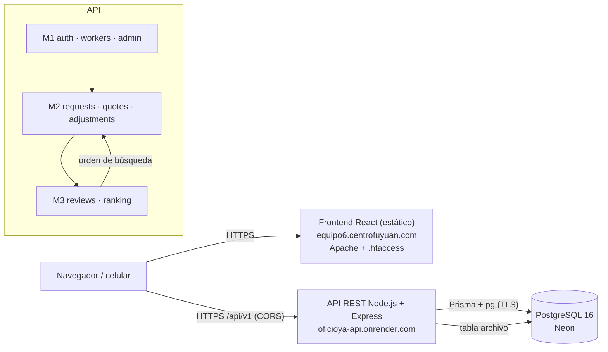

# Validación y entrega final — OficioYa

| Campo | Valor |
|---|---|
| Proyecto | OficioYa: plataforma web de oficios con reputación verificada |
| Equipo | Equipo 6: Javier Alejandro Santiago Salinas, Alejandro Lita Camacho, Jesus Eduardo Pineda Alcazar y Manuel Alfonso Castillo Moar |
| Integrante que entrega | Javier Alejandro Santiago Salinas |
| URL del sistema final | https://equipo6.centrofuyuan.com |
| URL de la API | https://oficioya-api.onrender.com (salud: `/api/v1/health`) |
| Repositorio | https://github.com/Sjaviercito/oficioya (privado; pedir acceso al equipo) |
| Versión final del sistema | 2.1 (2026-11-26) |
| Versión final del contrato técnico | 1.1: `docs/02-contrato-tecnico_OficioYa.md` en el repositorio |

### Acceso para evaluar

Cuentas **ficticias**; contraseña para todas: `OficioYa2026!`

| Correo | Rol |
|---|---|
| `cliente@oficioya.test` | Cliente (tiene una solicitud abierta de Plomería en Centro) |
| `trabajador@oficioya.test` | Trabajador verificado de Plomería en Centro |
| `admin@oficioya.test` | Administrador (verifica identificaciones) |
| `trabajadorb@oficioya.test`, `trabajadorc@oficioya.test`, `trabajadord@oficioya.test` | Trabajadores de demostración del ranking (3.49, "Nuevo" y sin verificar) |

> La API está en el plan gratuito de Render: si nadie la usó en 15 minutos, **la primera petición tarda cerca de un minuto**. Abrir antes `https://oficioya-api.onrender.com/api/v1/health` y esperar `{"ok":true}`.

**Cómo probar el cambio de esta etapa (ajuste de precio):**
1. Trabajador → **Trabajos** → abrir la solicitud de Ana → enviar cotización de $800.
2. Cliente → aceptar la cotización. Trabajador → **Iniciar trabajo**.
3. Trabajador → **Ajustes de precio** → proponer $1,000 con motivo "Material adicional para la pared". Proponer $1,300 muestra el error del tope.
4. Cliente → intentar **Confirmar que el trabajo terminó** (bloqueado por el ajuste pendiente) → **Aceptar $1,000** → confirmar → calificar (muestra el monto final de $1,000).
5. Trabajador → **Mi perfil**: el panel muestra el porcentaje de trabajos con ajuste.

---

## 1. Validación con usuarios

| Fuente | Qué se observó | Evidencia |
|---|---|---|
| Corrección solicitada por el usuario (simulación del profesor, Equipo 6) | 4 de 8 clientes reportaron cobros finales mayores a lo cotizado. Una vez aceptada la cotización no hay forma de cambiar el monto en el sistema: el trabajador solo puede cancelar (y se penaliza), así que el cobro extra ocurre fuera de la plataforma, sin registro. Cita del usuario: *"Quiero que me proponga el nuevo monto aquí, que yo decida si acepto, y que quede constancia. Y quiero poder ver si un trabajador siempre sube el precio."* | Enunciado de la Etapa 4 |
| Prueba del MVP desplegado por el equipo y compañeros en clase (Etapa 3) | El inicio de sesión mostraba un error técnico en inglés (*"Cannot destructure property 'accessToken'..."*) cuando el frontend no apuntaba a la API. En otro momento, las credenciales de prueba respondieron "Correo o contraseña incorrectos" en producción. | Capturas del equipo (pestaña Network: la petición iba al servidor del curso en lugar de Render) |
| Despliegue en el servidor del curso | La carpeta `private` es accesible desde el navegador: se pudo abrir `package.json` del backend por URL pública. El servidor no ejecuta Node.js. | Prueba con `prueba.html`/`prueba.php` y acceso a `private/backend/package.json` |
| Uso continuo en Render (plan gratuito) | La primera petición tras 15 minutos sin uso tarda alrededor de un minuto; las fotos subidas desaparecen después de un reinicio. | Mensaje de Render en el panel del servicio |

---

## 2. Hallazgos consolidados

Prioridad: severidad (impacto en el usuario o en la seguridad) × frecuencia. Se atendió primero lo crítico y lo que rompe la promesa central ("precio claro antes de empezar").

| ID | Hallazgo | Tipo | Severidad | Prioridad | Estado |
|---|---|---|---|---|---|
| H-01 | `.env` con credenciales potencialmente descargable desde la carpeta `private` del servidor del curso | Bug (seguridad / despliegue) | Crítica | 1 | ✅ Mitigado: backend retirado del servidor, claves de Neon, `JWT_SECRET` e `IDENTITY_ENC_KEY` rotadas; la API se movió a Render |
| H-02 | No existe forma de ajustar el precio después de aceptar la cotización; el cobro extra ocurre fuera de la plataforma | Requisito faltante | Alta | 2 | ✅ Corregido (C-01: RF-16 y RF-17) |
| H-03 | El cliente no puede detectar a un trabajador que "siempre sube el precio" | Requisito faltante | Media | 3 | ✅ Corregido (C-01: RF-17) |
| H-04 | Credenciales de prueba rechazadas en producción ("Correo o contraseña incorrectos") | Bug (datos / operación) | Alta | 4 | ⚠️ Causa: la base que usa Render no tenía el seed. Mitigación documentada (correr `npm run db:seed` con la `DATABASE_URL` de Render). [PENDIENTE: confirmar en la URL final antes de la evaluación] |
| H-05 | Mensaje técnico en inglés al iniciar sesión cuando la API responde algo que no es JSON | Usabilidad | Media | 5 | ✅ Corregido (C-03) |
| H-06 | Las fotos e identificaciones se pierden al reiniciarse la API (disco temporal de Render) | Requisito mal interpretado en el despliegue (ADR-05 pide disco persistente) | Alta | 6 | ✅ Corregido (C-05: archivos en PostgreSQL) |
| H-07 | La API tarda ~1 minuto en despertar | Usabilidad | Media | 7 | ❌ Pendiente conocido; mitigación operativa (abrir `/api/v1/health` antes) |
| H-08 | El panel del trabajador no mostraba la tasa de cancelación ni la calificación ponderada (RF-14 parcial) | Requisito faltante | Baja | 8 | ✅ Corregido (C-02) |
| H-09 | RF-11 (notificaciones), RF-12 (respuesta a reseñas) y RF-13 (reportes y suspensión) no implementados | Requisito faltante | Media | 9 | ✅ Corregido (C-04) |

---

## 3. Cambios implementados

### C-01: Ajuste de precio con aprobación del cliente (H-02, H-03)

| Paso | Detalle |
|---|---|
| **Origen** | Corrección solicitada por el usuario: 4 de 8 clientes reportaron cobros mayores a lo cotizado; el cobro extra sucedía fuera de la plataforma. |
| **Requisito o criterio afectado** | Nuevos **RF-16** (ajuste de precio, Must) y **RF-17** (porcentaje con ajuste, Should). Se afinó la regla de RF-07: confirmar "terminado" ahora se bloquea si hay un ajuste pendiente (CA-16.8). Sin cambios en la máquina de estados (sección 3.3) ni en la fórmula del ranking (sección 3.4). |
| **Cambio en el contrato** | Contrato **v0.3 → v1.0**: nueva sección 3.5 (reglas y endpoints), criterios CA-16.1 a CA-16.9 y CA-17.1 a CA-17.2, RF-16 y RF-17 en el alcance, historial actualizado. Decisiones tomadas como "cliente": tope de **+50 % sobre la cotización original**; solo aumentos; un pendiente a la vez; **confirmar con ajuste pendiente se bloquea (409)**, no se rechaza en automático, para que el cliente siempre decida; cancelar deja el ajuste pendiente como rechazado; el porcentaje es solo transparencia y **no toca el ranking**. |
| **Cambio en el código** | Tabla `ajuste_precio` y columna `trabajos_con_ajuste` (`backend/prisma/migrations/20261125000000_ajuste_precio/migration.sql`), con `CHECK (monto_propuesto > monto_anterior)` e índice único parcial (un pendiente por solicitud). Módulo nuevo `backend/src/modules/adjustments/` (`reglas.js`, `schemas.js`, `service.js`, `routes.js`). `requests/service.js`: `montoFinal` e historial en el detalle, bloqueo al completar, rechazo al cancelar y conteo al completar. `workers/service.js` y `quotes/service.js`: `porcentajeConAjuste`. Frontend: sección "Ajustes de precio" en `pages/DetalleSolicitud.jsx`, monto final al reseñar y porcentaje en `components/TarjetaTrabajador.jsx`. |
| **Verificación** | 7 pruebas unitarias (`tests/unit/ajustes.test.js`) y 12 de integración (`tests/integracion/flujo.test.js`, bloque "RF-16 / RF-17") contra PostgreSQL real. **Suite completa: 92 pruebas pasando** (95 tras C-04) (antes 73; las 73 originales siguen pasando sin modificar la fórmula del ranking). Recorrido manual en la sección "Cómo probar el cambio". |

**Criterio principal (Given/When/Then)**: *Dado* un trabajo `en_curso` aceptado en $800, *cuando* el trabajador propone $1,000 por "material adicional" y el cliente acepta, *entonces* el monto final es $1,000 y queda el historial $800 → $1,000. Errores: $1,300 → 422; solicitud en `aceptada` → 409; segunda propuesta con una pendiente → 409; cliente ajeno → 403.

### C-02: Panel del trabajador completo (H-08)

| Paso | Detalle |
|---|---|
| **Origen** | Trazabilidad de la Etapa 3: RF-14 quedó ⚠️ parcial. |
| **Requisito afectado** | RF-14 (Could) → entra al alcance en el contrato v1.0 (CA-14.1). |
| **Cambio en el contrato** | RF-14 marcado "Sí (v1.0)" con CA-14.1. |
| **Cambio en el código** | `frontend/src/pages/MiPerfil.jsx`: reputación, calificación ponderada, trabajos completados, tasa de cancelación y porcentaje con ajuste. La API ya devolvía los datos (`workers/service.js`, `serializarPerfil`). |
| **Verificación** | CA-17.1 comprueba `porcentajeConAjuste` en `GET /workers/me/profile`; revisión visual en "Mi perfil". |

### C-03: Mensaje claro cuando el servidor no responde como la API (H-05)

| Paso | Detalle |
|---|---|
| **Origen** | Error *"Cannot destructure property 'accessToken' of 'object null'"* visto al desplegar. |
| **Requisito afectado** | RF-01 (CA-01.3, la experiencia de error) y RNF de usabilidad. Sin cambio de criterios. |
| **Cambio en el contrato** | Ninguno (corrección de implementación). |
| **Cambio en el código** | `frontend/src/api/client.js`: si la respuesta no es JSON, muestra "No se pudo conectar con el servidor de OficioYa. Intenta de nuevo en un minuto." |
| **Verificación** | Manual: compilar sin `VITE_API_URL` e intentar entrar muestra el mensaje en español. |

### C-04: Requisitos pendientes para completar el producto (H-09)

| Paso | Detalle |
|---|---|
| **Origen** | Trazabilidad de la Etapa 3: RF-11, RF-12 y RF-13 quedaron ❌. La etapa pide completar todos los pendientes. |
| **Requisito afectado** | RF-11 (avisos), RF-12 (respuesta a reseñas), RF-13 (reportes y suspensión). |
| **Cambio en el contrato** | v1.0: RF-11 se implementa como **avisos dentro de la app** (no correo ni push; esos quedan como mejora futura). RF-12: una sola respuesta, solo el trabajador calificado (403 otro, 409 segunda). RF-13: el cliente reporta al trabajador de una solicitud aceptada suya (una vez por solicitud, 409); el admin suspende o descarta; un trabajador **suspendido** no aparece en búsquedas, no ve solicitudes disponibles y no cotiza (403). |
| **Cambio en el código** | Migración `20261125010000_pendientes` (tablas `notificacion` y `reporte`, columnas `suspendido` y `respuesta`). Módulo `backend/src/modules/extras/routes.js` y `shared/avisos.js` (avisos al recibir cotización, al aceptar, al proponer y al responder ajustes). Frontend: `pages/Avisos.jsx`, respuesta y reporte en `pages/DetalleSolicitud.jsx`, sección de reportes en `pages/Verificaciones.jsx`. |
| **Verificación** | 3 pruebas de integración nuevas (CA-11.1, CA-12.1, CA-13.1): **95 pruebas pasando**. |

### C-05: Mejoras del contrato v1.1 (H-06 y mejoras detectadas en el desarrollo)

| Paso | Detalle |
|---|---|
| **Origen** | Hallazgo H-06 y siete mejoras detectadas por el equipo durante el desarrollo y el despliegue (sección 6.7). |
| **Requisito o criterio afectado** | Nuevos RF-18 (perfil público) y RF-19 (tope por oficio). Ampliados RF-11 (avisos por oficio y zona) y RF-13 (reactivación). **Cambia la fórmula del ranking** (sección 3.4): se agrega un factor de hasta −10 % por la proporción de trabajos con ajuste. Nuevos CA-10.6, CA-10.7, CA-11.2, CA-13.2, CA-18.1, CA-19.1, CA-SEG.1 y CA-ARCH.1. |
| **Cambio en el contrato** | v1.0 → **v1.1**: sección 3.6 con todas las reglas, ADR-05 revisado (archivos en PostgreSQL), y la cookie `HttpOnly` **descartada** con su razón (dominios distintos; los navegadores bloquean cookies entre sitios), reemplazada por una CSP. |
| **Cambio en el código** | Migración `20261126000000_mejoras_v11` (tabla `archivo`, columna `oficio.tope_ajuste` con `CHECK`). `shared/storage/index.js` guarda y lee de la base; `/uploads` solo sirve archivos públicos. `ranking/calculo.js` (`PESO_AJUSTE`). `adjustments/reglas.js` (`topeDe`). `extras/routes.js` (perfil público, topes, suspendidos). `auth/routes.js` (límite de intentos). Frontend: `pages/Trabajador.jsx`, nombres enlazados en `TarjetaTrabajador.jsx`, secciones de topes y suspendidos en `Verificaciones.jsx`, CSP en `public/.htaccess`. |
| **Verificación** | **105 pruebas pasando** (10 nuevas). Recorrido completo con Playwright a 360 px servido con la CSP activa: cotizar → aviso → perfil público → aceptar → ajuste $800 → $1,000 → bloqueo al confirmar con ajuste pendiente → aceptar → reseña con monto final $1,000 → respuesta del trabajador → panel → topes del admin → sexto intento de login rechazado. Sin violaciones de CSP ni desplazamiento horizontal. |

---

## 4. Trazabilidad final

| RF | Prioridad | Criterios | Implementado en | Estado | Notas |
|---|---|---|---|---|---|
| RF-01 Registro e inicio de sesión | Must | CA-01.1 a CA-01.5 | `modules/auth/*` · `pages/Entrar.jsx`, `Registro.jsx` | ✅ | |
| RF-02 Perfil de trabajador | Must | CA-02.1 a CA-02.4 | `modules/workers/*` · `pages/MiPerfil.jsx` | ✅ | |
| RF-03 Verificación de identidad | Must | CA-03.1 a CA-03.5, CA-ARCH.1 | `modules/admin/*`, `shared/storage`, `shared/crypto.js` · `pages/Verificaciones.jsx` | ✅ | Desde v1.1 las imágenes cifradas viven en PostgreSQL |
| RF-04 Búsqueda por ranking | Must | CA-04.1 a CA-04.4 | `workers/service.js`, `ranking/calculo.js` · `pages/Buscar.jsx` | ✅ | Ahora muestra el porcentaje con ajuste |
| RF-05 Crear solicitud | Must | CA-05.1 a CA-05.4 | `modules/requests/*` · `pages/NuevaSolicitud.jsx` | ✅ | |
| RF-06 Enviar cotización | Must | CA-06.1 a CA-06.5 | `modules/quotes/*` · `pages/DetalleSolicitud.jsx` | ✅ | |
| RF-07 Estados de la solicitud | Must | CA-07.1 a CA-07.5 y CA-16.8 | `requests/estados.js`, `requests/service.js` | ✅ | Completar se bloquea con ajuste pendiente (v1.0) |
| RF-08 Cancelaciones | Must | CA-08.1 a CA-08.5 y CA-16.9 | `requests/service.js` (`cancelar`) | ✅ | Cancelar rechaza el ajuste pendiente (v1.0) |
| RF-09 Reseñas | Must | CA-09.1 a CA-09.6 | `modules/reviews/*` | ✅ | El formulario muestra el monto final |
| RF-10 Recálculo del ranking | Must | CA-10.1 a CA-10.5 | `ranking/*`, `server.js` (cron 03:00) | ⚠️ | Fórmula sin cambios y verificada; el cron no corre si Render está dormido (`npm run ranking:recalc` como respaldo) |
| RF-11 Avisos | Should | CA-11.1, CA-11.2 | `modules/extras/routes.js`, `shared/avisos.js` · `pages/Avisos.jsx` | ✅ | Avisos dentro de la app; correo y push como mejora futura (C-04) |
| RF-12 Respuesta a reseñas | Should | CA-12.1 | `modules/extras/routes.js` · `pages/DetalleSolicitud.jsx` | ✅ | Una respuesta por reseña (C-04) |
| RF-13 Reportes y suspensión | Should | CA-13.1, CA-13.2 | `modules/extras/routes.js`, `workers/service.js`, `quotes/service.js` · `pages/Verificaciones.jsx` | ✅ | Suspendido no aparece ni cotiza (C-04) |
| RF-14 Panel del trabajador | Could | CA-14.1 | `pages/MiPerfil.jsx` | ✅ | C-02 |
| RF-15 Historial del cliente | Could | (Etapa 3) | `GET /requests/mine` · `pages/MisSolicitudes.jsx` | ✅ | |
| **RF-16 Ajuste de precio** | **Must** | **CA-16.1 a CA-16.9** | `modules/adjustments/*`, migración `20261125000000_ajuste_precio` · `pages/DetalleSolicitud.jsx` | ✅ | **Nuevo (C-01)** |
| **RF-17 Porcentaje con ajuste** | **Should** | **CA-17.1, CA-17.2, CA-10.6, CA-10.7** | `workers/service.js`, `quotes/service.js`, `ranking/calculo.js` · `TarjetaTrabajador.jsx`, `MiPerfil.jsx` | ✅ | **Nuevo (C-01)**; desde v1.1 pesa hasta −10 % en el ranking |
| **RF-18 Perfil público** | **Should** | **CA-18.1** | `extras/routes.js` · `pages/Trabajador.jsx` | ✅ | **Nuevo (C-05)** |
| **RF-19 Tope por oficio** | **Could** | **CA-19.1** | `adjustments/reglas.js`, `extras/routes.js` · `pages/Verificaciones.jsx` | ✅ | **Nuevo (C-05)** |

**Resumen:** 19 RF: **18 ✅**, **1 ⚠️** (RF-10, por el cron en Render dormido), **0 ❌**.

| Prioridad | Total | ✅ | ⚠️ | ❌ |
|---|---|---|---|---|
| Must | 11 | 10 | 1 | 0 |
| Should | 5 | 5 | 0 | 0 |
| Could | 3 | 3 | 0 | 0 |

**Requisitos no funcionales:**

| RNF | Estado final | Verificación |
|---|---|---|
| RNF-01 Rendimiento (p95 < 2 s, 500 trabajadores) | ⚠️ Sin prueba k6 | Pendiente conocido |
| RNF-02 Seguridad (bcrypt, HTTPS, sesión de 24 h; v1.1: límite de intentos y CSP) | ✅ | Pruebas de integración de bcrypt y del refresh token; `FORCE_HTTPS=true` en Render y redirección comprobada |
| RNF-03 INE cifradas, solo admin | ✅ | Pruebas unitarias y de integración del cifrado y del 403 |
| RNF-04 Dirección exacta protegida | ✅ | Pruebas que revisan que el JSON no la contenga |
| RNF-05 Responsive 360 px | ⚠️ | Prueba automatizada a 360 px; falta evidencia en celular real |
| RNF-06 Solicitud en ≤ 5 pantallas | ✅ | 3 pantallas |

---

## 5. Calidad y seguridad

- **Credenciales fuera del repositorio:** `.env` y `.env.production` en `.gitignore`; solo `.env.example` sin secretos. En Render, `DATABASE_URL` se capturó en el panel y `JWT_SECRET` e `IDENTITY_ENC_KEY` los generó Render (`render.yaml`).
- **Consultas parametrizadas:** solo métodos de Prisma; no hay `$queryRawUnsafe` ni `$executeRawUnsafe`.
- **Contraseñas:** bcrypt costo 10. Refresh tokens guardados como hash SHA-256.
- **Validación en servidor:** zod en cada módulo, tipo real de imágenes, y `CHECK` / `UNIQUE` en la base, incluido el nuevo `CHECK` de aumento y el índice único parcial de ajustes pendientes.
- **Datos de prueba:** todos ficticios (`@oficioya.test`, direcciones inventadas).
- **Incidente H-01** documentado y mitigado: claves rotadas y backend retirado del servidor público.

---

## 6. Documentación SSOT

### 6.1 Arquitectura



El frontend es estático y se sirve desde el subdominio del curso. Toda la lógica de negocio (máquina de estados, ranking y ajustes) vive en la API, que la app móvil podría reutilizar sin cambios (ADR-01). La base de datos es PostgreSQL administrado en Neon.

### 6.2 Stack y versiones

| Capa | Tecnología |
|---|---|
| Frontend | React 18.3, React Router 7, Vite 6.4 |
| Backend | Node.js 22+ (probado en 22 y 26), Express 5, zod 4, multer 2, helmet 8, jsonwebtoken 9, bcryptjs 3, node-cron 4 |
| Datos | Prisma 6.19 (cliente sin motor binario + `@prisma/adapter-pg`), PostgreSQL 16 (Neon) |
| Pruebas | Jest 29, Supertest 7 (105 pruebas), Playwright (revisión de interfaz) |
| Despliegue | Render (API, plan gratuito, `render.yaml`), servidor Apache del curso (frontend), GitHub |

### 6.3 Ejecución local

```bash
# Backend
cd backend
cp .env.example .env              # llenar DATABASE_URL, JWT_SECRET e IDENTITY_ENC_KEY
npm install
npx prisma migrate deploy         # aplica las 5 migraciones
npm run db:seed                   # datos ficticios (solo si la base está vacía)
npm run dev                       # http://localhost:3000

# Frontend (otra terminal)
cd frontend
npm install
npm run dev                       # http://localhost:5173

# Pruebas (base aparte: se borra en cada ejecución)
cd backend
DATABASE_URL_TEST="postgresql://.../oficioya_test" npm test
```

**Despliegue:** `git push` a `main` → Render reconstruye la API y aplica migraciones (`render.yaml`). Frontend: `frontend/.env.production` con `VITE_API_URL=https://oficioya-api.onrender.com` → `npm run build` → subir `index.html`, `assets/` y `.htaccess` a la raíz del FTP.

### 6.4 Decisiones de arquitectura vigentes

| ADR | Decisión | Estado |
|---|---|---|
| ADR-01 | API REST primero (`/api/v1`), la web es un cliente | ✅ Vigente. Permitió separar frontend y API cuando el hosting no ejecutó Node |
| ADR-02 | Node + Express, PostgreSQL, React | 🔄 **Cambió (v0.3):** Node 22 en lugar de 20 (fin de soporte); Prisma sin motor binario con el adaptador `pg`; zod 4, Express 5 y React Router 7 por vulnerabilidades; bcryptjs en lugar de bcrypt (sin compilación nativa) |
| ADR-03 | Web mobile-first | ✅ Vigente |
| ADR-04 | JWT de 15 min + refresh token rotativo de 24 h | ✅ Vigente; se agregó la tabla `refresh_token` |
| ADR-05 | Identificaciones cifradas en almacenamiento privado | 🔄 **Cambió (v1.1):** los archivos se guardan en la tabla `archivo` de PostgreSQL (INE cifradas y privadas), porque el disco de Render gratuito se borra. Costo: usa espacio de la base (1 GB en Neon gratuito). Se cambió solo `shared/storage`, sin tocar los módulos |
| ADR-06 | Reglas centralizadas: máquina de estados y ranking en servicios | ✅ Vigente; el ajuste de precio se agregó como registro aparte, **sin estados nuevos** |
| Ranking (v1.1) | La proporción de trabajos con ajuste resta hasta 10 % de la puntuación | 🔄 **Cambió:** antes era solo transparencia; con 0 ajustes el resultado es idéntico (CA-10.7) |
| ADR-04 | (complemento v1.1) | 🔄 La cookie `HttpOnly` se **descartó** (cookies entre sitios bloqueadas); se agregó CSP y límite de intentos |
| ADR-07 (nuevo, v1.0) | El ajuste de precio es una entidad independiente con reglas puras en `adjustments/reglas.js` y garantías en la base (`CHECK` de aumento e índice único parcial) | ✅ Nuevo: evita romper los criterios de RF-07 y la fórmula del ranking |
| Despliegue (v0.3) | Frontend en el subdominio del curso, API en Render, base en Neon | 🔄 **Cambió:** el servidor del curso no ejecuta Node y su carpeta `private` es pública |

### 6.5 Changelog

| Versión | Fecha | Cambios |
|---|---|---|
| Contrato 0.1 → 0.2 | 2026-09-22 → 2026-10-06 | Visión y contrato técnico: ADR, modelo de datos, máquina de estados y criterios con datos concretos |
| Sistema 1.0 (MVP) / contrato 0.3 | 2026-11-04 | RF-01 a RF-10 y RF-15; 73 pruebas; despliegue frontend + Render + Neon; incidente del `.env` y rotación de claves; dependencias recortadas de 190 MB a 27 MB |
| Sistema 2.0 / contrato 1.0 | 2026-11-25 | **RF-16 ajuste de precio** con aprobación del cliente y **RF-17 porcentaje con ajuste** (C-01); RF-14 panel completo (C-02); mensaje de error claro cuando la API no responde (C-03); avisos en la app, respuesta a reseñas y reportes con suspensión (C-04, RF-11 a RF-13); 98 pruebas |
| Sistema 2.1 / contrato 1.1 | 2026-11-26 | Archivos persistentes en PostgreSQL, perfil público (RF-18), tope por oficio (RF-19), ajustes en el ranking, avisos por oficio y zona, reactivación de suspendidos, límite de intentos de login, CSP; 105 pruebas |

### 6.6 Pendientes conocidos

| Pendiente | Impacto | Propuesta |
|---|---|---|
| RF-11 solo dentro de la app | Sin correo ni notificaciones push | Correo con Resend o SendGrid |
| Espacio de archivos | Las imágenes ocupan la base de datos (1 GB gratuito) | Migrar `shared/storage` a un bucket privado si crece el uso |
| H-07 API dormida | ~1 minuto en la primera petición | Plan de pago, o un ping programado (por ejemplo cron-job.org) que también dispare el recálculo de las 03:00 (RF-10) |
| H-04 Seed en producción | Las cuentas de prueba pueden no existir si la base se reinicia | Script de seed idempotente que agregue solo los usuarios de prueba faltantes |
| RNF-01 sin k6, RNF-05 sin celular real | Rendimiento y compatibilidad sin evidencia formal | Correr k6 contra Render con 500 trabajadores semilla; capturas en Android e iPhone |
| Seguridad | Refresh token en `localStorage` (mitigado con CSP); el límite de intentos vive en memoria y se reinicia con la API | Servir frontend y API en el mismo dominio para usar cookie `HttpOnly`; límite de intentos en la base |

### 6.7 Mejoras del contrato v1.1

Las siete mejoras detectadas durante el desarrollo quedaron implementadas y probadas (detalle en C-05 y en la sección 3.6 del contrato).

| # | Mejora | Resultado |
|---|---|---|
| 1 | Archivos persistentes | ✅ En PostgreSQL en lugar de un bucket externo (no requiere cuentas nuevas) |
| 2 | Avisos por oficio y zona | ✅ CA-11.2 |
| 3 | Perfil público del trabajador | ✅ RF-18, CA-18.1 |
| 4 | Seguridad de sesión | ✅ Límite de intentos (CA-SEG.1) y CSP; la cookie `HttpOnly` se descartó por la arquitectura de dominios separados |
| 5 | Tope por oficio | ✅ RF-19, CA-19.1 |
| 6 | Ajustes en el ranking | ✅ CA-10.6 y CA-10.7 (hasta −10 %) |
| 7 | Reactivar suspendidos | ✅ CA-13.2, con interfaz para el admin |

---

## 7. Uso de IA y reflexión

| Agente | Para qué se usó | Qué se tuvo que corregir a mano |
|---|---|---|
| Nemotron (opencode) | Primer borrador del contrato técnico (v0.1) | IDs de requisitos, relaciones del modelo de datos y criterios que no eran verificables |
| Claude (Anthropic) | Revisión del contrato (v0.2), generación del MVP (API, migraciones, seed, frontend y pruebas), diagnóstico del despliegue y, en esta etapa, implementación del ajuste de precio (RF-16/17), contrato v1.0 y este documento | Al empaquetar omitió `src/shared/storage/index.js` y la API no arrancaba (se creó a mano). Su primer plan de despliegue asumió que el servidor del curso ejecutaba Node: el backend se subió a `private`, que resultó pública, y hubo que retirarlo y rotar claves. El `node_modules` subido inicialmente excedió el límite de 200 MB del hosting. Configurar `.env.production` en Windows requirió varios intentos guiados. Al final se planteó marcar las mejoras propuestas como terminadas antes de implementarlas; se decidió implementarlas y probarlas primero, y solo después actualizar la trazabilidad. |

**Reflexión:** la IA fue muy buena para convertir criterios Given/When/Then en código y en pruebas con el ID de cada criterio, lo que hizo la trazabilidad casi automática y permitió agregar el ajuste de precio sin romper las 73 pruebas originales. Donde falló fue en suponer el entorno: asumió un servidor con Node y no anticipó que la carpeta `private` fuera pública ni el límite de 200 MB, y eso causó un incidente de seguridad real. También empaquetó mal un archivo clave. La próxima vez verificaríamos primero las restricciones del hosting (qué ejecuta, qué es público, cuánto espacio hay) y revisaríamos cada paquete antes de subirlo, en lugar de confiar en que "ya funcionó en local".
